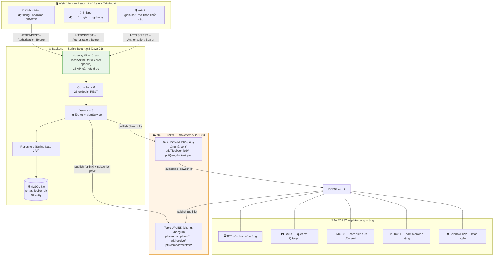
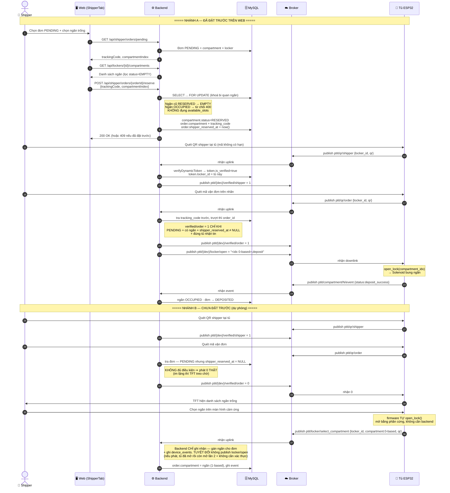
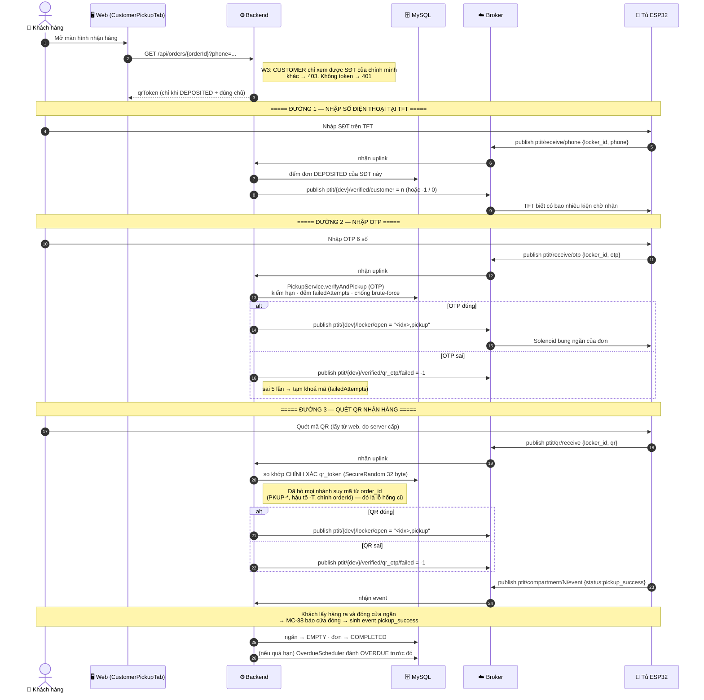

# SƠ ĐỒ HỆ THỐNG SMART LOCKER

> Ba sơ đồ Mermaid dưới đây mô tả **đúng luồng đang chạy trong code**, không phải luồng mong muốn.
> Số liệu (đếm từ mã nguồn): **26 endpoint / 6 controller / 8 service / 10 entity / 14 component**.
> Mọi topic lấy từ `MQTT_GUIDE.md`; giới hạn bảo mật lấy từ `docs/GIOI-HAN-BAOMAT.md`.

---

## 1. Kiến trúc tổng thể

**Ghi chú thiết kế — vì sao UPLINK và DOWNLINK khác quy ước tên:**

> **Uplink dùng topic CHUNG, không chứa `{id}`; downlink dùng topic RIÊNG từng tủ, có `{id}`.**
>
> Lý do: nhiều tủ phải cùng publish lên **một** topic (ví dụ `ptit/status`) thì thiết bị nào chỉ cần biết 1 topic là gửi được — id của tủ nằm trong **payload** (`locker_id`). Ngược lại, lệnh mở tủ là lệnh **nguy hiểm**, phải đến **đúng một** tủ; nếu dùng topic chung thì mọi tủ đều nhận và đều mở → thảm hoạ. Vì vậy downlink bắt buộc có `{id}`.
>
> **Đánh đổi:** mỗi bản tin uplink đều phải parse JSON để biết tủ nào → tốn CPU và dễ lỗi nếu firmware quên `locker_id` (đúng là chuyện đang xảy ra, xem giới hạn #3 trong `GIOI-HAN-BAOMAT.md`). Nhưng nếu đảo lại (uplink có id) thì mỗi tủ phải publish N topic khác nhau và backend phải subscribe wildcard nhiều tầng — phức tạp hơn mà lợi ích không có.

> ⚠️ **Giới hạn bảo mật (xem `GIOI-HAN-BAOMAT.md` #1):** broker `broker.emqx.io` là broker **công cộng, KHÔNG xác thực** (`mqtt.username` rỗng, `mqtt.ssl.enabled=false`). Ai biết tên topic đều publish được lệnh mở tủ. Đây là lý do nhánh downlink phải có id — nhưng **id không phải bí mật**, nên biện pháp thật là broker riêng + TLS + ACL.

---

## 2. Tuần tự — Shipper nạp hàng (2 nhánh)

Điểm mới của giai đoạn T3: shipper **được chọn trước ngăn trên web**, nhưng vẫn giữ được nhánh cũ (đến tủ mới chọn trên TFT).

**Ghi chú thiết kế — vì sao nhánh B vẫn tồn tại:**

> **Đánh đổi của Q2 ("shipper chọn ngăn trên web"):** luồng đặt trước chỉ áp dụng cho ca shipper **có dùng web trước khi đến tủ**. Nhưng thực tế shipper có thể đến tủ mà chưa đặt trước (mất mạng, quên, đơn phát sinh). Nếu bỏ nhánh B thì shipper đó **không giao được hàng nào** — tủ không có đường nào để mở. Vì vậy nhánh B giữ lại làm **dự phòng**, do firmware tự mở và backend chỉ ghi nhận.
>
> **Cái giá:** hệ thống có **hai** đường mở tủ khác nhau, nên bề mặt tấn công rộng hơn (nhánh B không cần xác thực shipper ở phía backend — firmware tự quyết). Đây là lý do `handleSelectCompartment` **bỏ hẳn** `publishCommand`: backend không được phát lệnh mở từ gói tin này, nếu không thì ai publish được `select_compartment` là mở được tủ.

**Ghi chú thiết kế — vì sao `verified/order = 0` phải phát thật:**

> TFT là máy trạng thái hữu hạn: sau khi quét mã đơn, nó **chờ** một trong hai giá trị `1` hoặc `0` trên `ptit/{dev}/verified/order`. Nếu backend "im lặng" khi đơn không đủ điều kiện (thay vì phát `0`), TFT **treo vô hạn** ở màn hình chờ. Người dùng thấy tủ "đơ". Vì vậy mọi nhánh từ chối đều phải phát `0`.

---

## 3. Tuần tự — Khách nhận hàng

**Ghi chú thiết kế — vì sao mã QR nhận hàng KHÔNG suy ra từ `order_id`:**

> **Vấn đề cũ:** mã nhận hàng từng là `"PKUP-" + orderId`. Ai biết mã đơn (in trên nhãn, hiện trên web) là suy ra được mã mở tủ. Tệ hơn, `PickupService` còn chấp nhận chính `orderId` làm mã hợp lệ.
>
> **Cách chọn:** sinh `qrToken` bằng `SecureRandom` 32 byte (256 bit) → Base64URL 43 ký tự, kiểm trùng tối đa 5 lần trước khi lưu. Mã **không suy được** từ bất kỳ dữ liệu đơn nào.
>
> **Đánh đổi:** (1) mã **không thể tính lại** — mất mã là phải cấp lại, không "tính lại từ orderId" được như trước; (2) phải thêm cột `qr_token` UNIQUE + index để tra cứu điểm, tốn chỗ hơn; (3) khi khách mở web, mã phải **gọi API** lấy từ server chứ không tự sinh ở client — nghĩa là mất mạng thì không hiện được mã (trước đây vẫn sinh được mã giả, nhưng mã giả đó vô dụng vì không mở được tủ thật).

**Ghi chú thiết kế — vì sao phải có cả OTP và QR:**

> OTP dùng khi khách không mở được web (máy hết pin, không có mạng) — chỉ cần đọc 6 số trên màn hình. QR dùng khi khách có web — quét nhanh, không phải gõ. Hai đường cùng ghi vào `pickup_credentials` và cùng gọi `verifyAndPickup`, nên luật bảo mật (hạn, số lần sai, trạng thái đơn) chỉ viết **một lần**.
>
> **Đánh đổi:** bề mặt tấn công gấp đôi (2 cách đoán mã). Bù lại, `failedAttempts` và `expiredAt` dùng chung nên brute-force một đường cũng bị khoá luôn đường kia.
